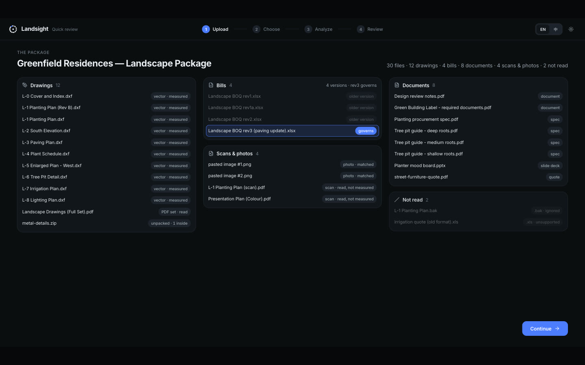
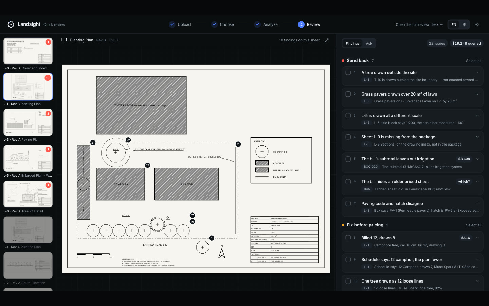
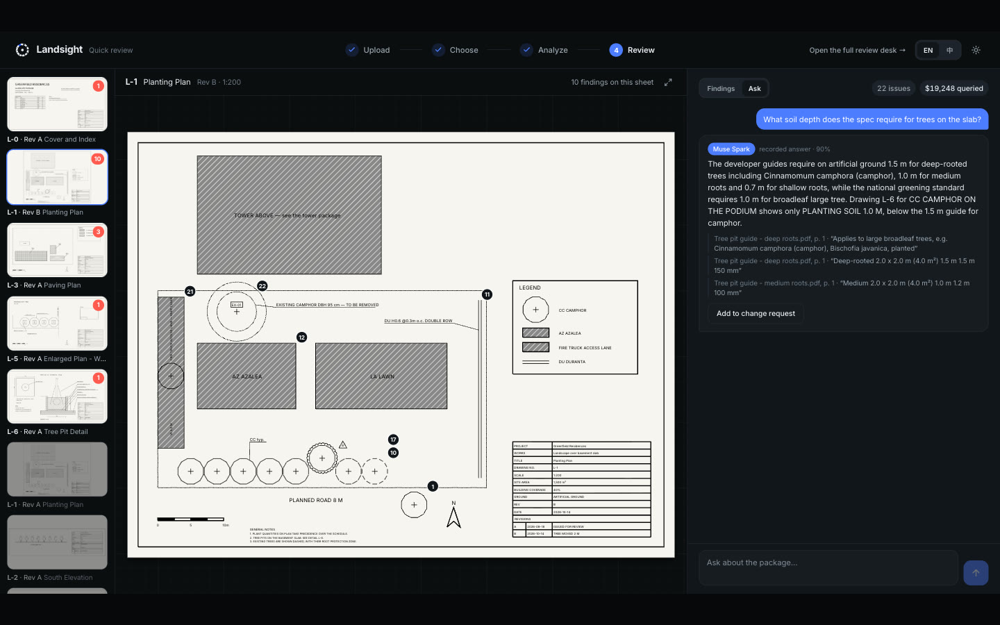
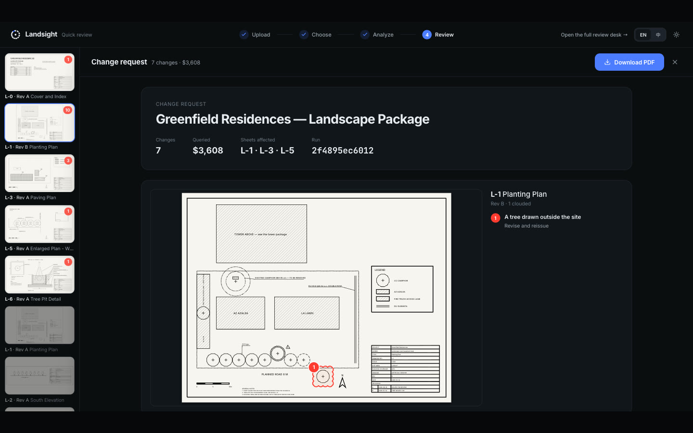
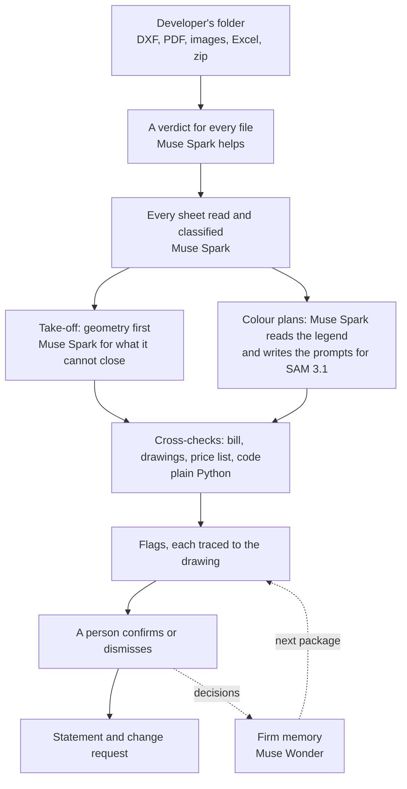

# Landsight

**Landsight reviews a developer's drawing package the way a design firm's estimator does: it reads every
file, counts what is drawn, reads what is written, measures what is exact, checks the bill and the building code
against the drawings, and shows where every number came from before it goes into a quote.**

Landscape comes first: that is what it is built for and scored on. Some checks are general (revisions, scale, the sheet
index, the bill's arithmetic), but so far they have been tested only on the landscape packages in this repository.

**Website:** https://landsight.co · **Try it in a browser, no install:** https://landsight.co/try (the sample package on
its recorded run) · **The 3-minute film:** https://www.youtube.com/watch?v=ObB8pePCIAo

| | |
| --- | --- |
|  |  |
|  |  |

## Reproduce it

Everything you need is in this repository: three sample packages with their answer keys (`samples/`), every recorded
Meta answer (`tests/fixtures/`), the backend and the screen. You need Python 3.13 with
[uv](https://docs.astral.sh/uv/) and Node 24. Verified from a fresh clone on macOS (Apple silicon) on 2026-11-05; other
systems have not been tried.

### 1. With no key: the recorded answers

Nothing is sent to a model. Terminal 1, the backend (the last command keeps running):

```bash
uv sync
uv run python -m landsight review samples/greenfield --fixtures
uv run python -m landsight serve --port 8795
```

The review prints `planted 30 · found 28 · flagged 2 · missed 0 · false alarms 0`. Terminal 2, the screen:

```bash
cd frontend
npm ci
npm run dev
```

Open http://localhost:5195; the first load opens the sample package (10–35 s). Without the backend, the screen shows the
same run from `frontend-mock/`.

| Sample | Command | Expected |
| --- | --- | --- |
| The 30-file package | `uv run python -m landsight review samples/greenfield --fixtures` | planted 30 · found 28 · flagged 2 · missed 0 · false alarms 0 |
| Held-out package | `uv run python -m landsight review samples/heldout --fixtures` | planted 11 · found 10 · flagged 1 · missed 0 · false alarms 0 |
| 20-floor tower | `uv run python -m landsight review samples/tower --fixtures` | planted 10 · found 8 · flagged 2 · missed 0 · false alarms 0 |

The tests: `uv run pytest -q` (253 tests, 4–8 minutes) and `npm test` in `frontend/` (87 tests).

### 2. With your own keys: real model calls

```bash
cp .env.example .env    # fill in MODEL_API_KEY, and BASETEN_API_KEY for Muse Spark Open
```

Recorded answers replay even when a key is set, so the commands below say how to force real calls. Run them from the
repository root.

```bash
# Muse Spark 1.3 and SAM 3.1: ask all of the sample's calls again, about 50 (2–6 minutes, about $0.28)
uv run --env-file .env python -m landsight review samples/greenfield --live --fresh all --db out/live.db

# Muse Spark 1.3: a question nobody recorded
uv run --env-file .env python -m landsight ask "How many camphor trees are drawn on the planting plan, and how many does the bill price? Name the sheet and the bill row." --live --db out/live.db

# Muse Wonder: remove its two recorded answers first, or they replay
rm tests/fixtures/memory/*.json
uv run --env-file .env python -m landsight memory seed-sample --db out/firm.db
uv run --env-file .env python -m landsight memory distil --firm sample --live --db out/firm.db
uv run --env-file .env python -m landsight memory apply --firm sample --package samples/tower --live --db out/firm.db
git restore tests/fixtures/memory

# Muse Spark Open on Baseten: every Muse Spark call again; SAM 3.1 stays on the Meta Model API, so this needs both keys (about 3 minutes, $0.23)
uv run --env-file .env python -m landsight review samples/greenfield --reader open --live --fresh all --db out/open.db

# The other two samples, on either model (add --reader open for Muse Spark Open; about 2 minutes each)
uv run --env-file .env python -m landsight review samples/heldout --live --fresh all --db out/heldout.db
uv run --env-file .env python -m landsight review samples/tower --live --fresh all --db out/tower.db
```

Every command above was run this way, and scored what the table in step 1 says. Model answers can differ a little from
run to run, so a real-call score can too.

**If a key is wrong,** the command stops with one line naming it (`MODEL_API_KEY was rejected (HTTP 401)`). A busy API or
a rate limit is tried again, up to three times. If a call still fails, the review says so at the end and exits with code
3: that score is not a full result, so run the command again.

To see real calls on the screen, start the backend with your keys and ask for them. When the review finishes, reload
the screen: the run says `live`, and a question in Ask that has no recording goes to Muse Spark.

```bash
uv run --env-file .env python -m landsight serve --port 8795
curl -X POST "http://localhost:8795/api/packages/1/review?live=1&fresh=all"    # from another terminal
```

**How to tell a real call from a replay.** The review prints `recorded` or the number of `live` calls beside each model. New answers appear under `tests/fixtures/`, in `fresh/`
beside the recordings or as a new SAM 3.1 recording (`git status` lists them), `uv run python -m landsight db calls --db <file>` prints
the call table, and in the API's Run, `timing.recorded` is `false`. Without `fresh`, `?live=1` asks only what is not
already recorded, so on the sample it makes no calls.

## How it is built

| Part | What it uses | Where |
| --- | --- | --- |
| Backend | Python 3.13, FastAPI, uvicorn (port 8795) | `landsight/app/` |
| Reading files and drawings | ezdxf, shapely, PyMuPDF, openpyxl, python-pptx | `landsight/ingest/`, `dxf/`, `geometry/`, `bill/` |
| Checks and rules | Plain Python, each constant cited in `rules.json`; no model judges them | `landsight/checks/`, `rules/` |
| Storage | SQLite (`landsight.db`, created on first run) | `landsight/store/` |
| Screen | React 19, TypeScript, Vite, Tailwind (port 5195) | `frontend/` |
| Models | The four in the table below, called over HTTPS with httpx | `landsight/meta/`, `review/spark.py`, `memory/` |
| Recording | Every model answer is saved and can replay with no key | `tests/fixtures/` |



In the private mode, Muse Spark Open takes every Muse Spark call in this picture. The private mode and firm memory run
from the command line and the API; they are not on the screen yet.

## Contents

- [The Meta engineering](docs/META.md): what is built around Muse Spark 1.3, SAM 3.1, Muse Spark Open and Muse Wonder,
  with the code paths.
- [Run it locally](docs/GUIDE.md#quick-start-try-it-in-the-browser), [accuracy](docs/GUIDE.md#accuracy),
  [limits](docs/GUIDE.md#limits), [repository layout](docs/GUIDE.md#layout) and
  [the synthetic drawings](docs/GUIDE.md#synthetic-drawings-answer-key-in-the-repository).
- [Status and roadmap](docs/ROADMAP.md): what works today, what doesn't yet, what comes next and what a prize would
  pay for.
- [Muse Spark Open, the evidence](docs/OPEN-WEIGHTS.md): the open-weight model, where it runs (Baseten), the run log and sample
  outputs.
- [Two opt-in modes](docs/NEW-MODES.md): the private reader on Muse Spark Open and firm memory on Muse Wonder.
- [The stack](docs/STACK.md): every Meta call, its cost and latency, recording and replay.
- [The API](docs/API.md), [the decision log](docs/DECISIONS.md) and [a judge's playbook](docs/JUDGE-PLAYBOOK.md).

## At a glance

- **What and for whom:** a review desk for landscape design firms that price a property developer's landscape package
  (DXF and PDF drawings, scans, Excel bills). It counts and measures what is drawn, cross-checks the bill against the
  drawings and the firm's price list, checks the local building code, and traces every number to the drawing.
- **Answer key** (synthetic packages, keys in the repository): of 30 errors planted in the 30-file sample package,
  **28 found, 2 flagged for a person, 0 missed**, 0 false alarms.
- **Held-out package** (another layout and seed, reviewed once live before any check was looked at against it):
  11 planted, **10 found, 1 flagged for a person, 0 missed**, 0 false alarms.
- **One live review** of the sample: 51 Meta calls (39 Muse Spark 1.3 + 12 SAM 3.1) in **2–6 minutes** with six calls in
  parallel (fastest 106 s), **$0.23** at list prices (every pass on the sample so far: $0.23–$0.28).
- **Two opt-in modes:** a private mode that runs every Muse Spark call on **Muse Spark Open**, Meta's open weights
  (the same scoreboard on the sample, $0.2253 for the review), and **firm memory**, where **Muse Wonder** learns a
  firm's habits from its estimator's decisions and drafts the next reply to the developer in the firm's terms.
- **Offline by default:** every Meta answer is recorded and replays with no key; **253 Python tests pass**
  offline (`uv run pytest -q`).
- **The 3-minute film:** https://www.youtube.com/watch?v=ObB8pePCIAo

## Which Meta models, and where each runs

| Model | What it does in Landsight | Where it runs |
| --- | --- | --- |
| Muse Spark 1.3 | Reads every sheet and document, writes SAM 3.1's prompts, answers questions about the package | Meta Model API |
| SAM 3.1 | Measures the colour plans | Meta Model API |
| Muse Wonder | Firm memory: learns a firm's habits from what its estimator confirms and dismisses | Meta Model API |
| **Muse Spark Open** (open weights, `meta-models/muse-spark-open-1026`) | The private mode: every Muse Spark call of a review and of Ask | **Baseten**, through its OpenAI-compatible endpoint. Any OpenAI-compatible server a firm runs can take its place with `LANDSIGHT_OPEN_BASE_URL`; so far it has been run on Baseten only. |

Switch to the open model with `--reader open`, `LANDSIGHT_READER=open` or `?reader=open`
([docs/NEW-MODES.md](docs/NEW-MODES.md)). The evidence for the open-weight run, with the model id, the run log with Baseten's response ids, screen captures
and sample outputs: [docs/OPEN-WEIGHTS.md](docs/OPEN-WEIGHTS.md).

## Status and plan

- **Works today:** the whole review on a 30-file package, the hosted product at
  [/try](https://landsight.co/try), 253 tests, the private mode on Muse Spark Open and firm memory
  on Muse Wonder (CLI and API). **Not yet:** real packages from working firms (synthetic only), native DWG, the two modes on the
  screen.
- **Next:** pilots with landscape design firms in Taiwan on a private deployment of Muse Spark Open, then the
  architecture and MEP firms that review the same packages.
- **Why it continues:** Landsight is meant to become a company. A prize would go into building it: the company itself,
  pilots on private deployments and the product work in [docs/ROADMAP.md](docs/ROADMAP.md).
- **Get in touch:** to bring Landsight to your country, to talk about funding, or to try it on your own packages,
  email **eric2612115@gmail.com**.

## What it does

A developer sends a folder: CAD sheets in two revisions, a backup copy, a scanned PDF, a coloured presentation plan,
four versions of the bill of quantities, an Excel 97 file, a zip of metal details, a slide deck. A design firm checks
it by hand for weeks before it can price the job. Landsight drops the whole folder in, gives every file a verdict and
a reason, reads every sheet, takes the quantities off the CAD with geometry, asks Muse Spark only what geometry cannot
settle (an outline drawn as twelve loose lines, a plant schedule, a tree-pit detail, a misspelt bill row), lets SAM
3.1 find the coloured areas with words Muse Spark read off the legend, and then traces every disagreement: the bill
prices 12 camphor trees, the schedule says 12, the drawing shows 8.

Nothing a model says is counted until it agrees with the drawing or a person confirms it. The regulation check
(the local building code's greening requirement, Art. 302, with the tree-pit rule for planting on a slab)
shows every term and the cheapest fixes, and stops at "the architect signs off". The sample package is synthetic,
built for this project with thirty planted errors and an answer key in the repository, so the result can be scored:

```
planted 30 · found 28 · flagged 2 · missed 0 · false alarms 0
```

(the two flagged for review are E15 and E18; the CLI prints them on the next line)

A held-out package, generated with another layout and a seeded subset of the errors (`landsight package <dir> --seed 7
--layout b`, samples/heldout) and reviewed once live before any check was looked at against it, scored:

```
planted 11 · found 10 · flagged 1 · missed 0 · false alarms 0
```

(H04, the protected-tree question, is the one flagged for review; nothing was missed). The tower package
(`--tower`, samples/tower: a 20-floor tower on six sheets) scores planted 10 · found 8 · flagged 2 · missed 0 · false alarms 0.
docs/STACK.md has the live pass, the calls and the cost.

## Full walkthrough: CLI, tests and the review desk

Two terminals, both at the repository root (Python 3.13 with uv, Node 24), with the command-line review and the tests before `serve`.

**Terminal 1 — the backend** (the last command keeps running; leave it open):

```bash
uv sync
uv run python -m landsight package /tmp/greenfield
uv run python -m landsight review "/tmp/greenfield/Greenfield Residences — Landscape Package" --fixtures
uv run pytest -q
uv run python -m landsight serve --port 8795
```

Or drag the folder onto the screen: `open /tmp/greenfield` (Finder hides /tmp), then drag `greenfield` onto the drop
zone at http://localhost:5195. The screen uploads its files to the API (out/uploads/, at most 100 MB and 500 files),
reviews them offline and shows the same scoreboard. Drag only the package folder and the scoreboard stays empty: the
answer key sits next to it.

**Terminal 2 — the frontend** (keeps running too):

```bash
cd frontend
npm ci
npm run dev
```

Then open:

- http://localhost:5195 — the product: the sheets, the take-off, the disagreement with its Confirm button, every
  check, the rules, the files and the scoreboard (the first load opens the sample package, 10–35 s). Click
  Confirm on the camphor row; the tally turns green.
- http://localhost:5195/?director=1&auto=1 — the film's scenes played by the app itself, on the same Run: the drop,
  the drawing waking up, the eye, hedge math, lines to colour, the gauge (twice), the bill traced, twelve again.
  Space steps scene by scene; `#scene=eye` jumps to one.

What each step shows: `package` writes the 30-file package, the firm's price list and the answer key (it overwrites
an earlier copy in the same folder); `review` prints every file verdict, the 22 sheets it read (20 DXF and vector
PDF pages, 2 raster pages read for their title blocks), the 12 take-off items (8 from the CAD, 4 measured by SAM 3.1 on
the raster plan, awaiting confirmation), 71 checks and the scoreboard line above;
`pytest` runs the Python tests, all passing (4–8 minutes on a laptop; the frontend's are `npm test` in frontend/); `serve` answers `GET /api/health` and prints its address only once
it is listening. Without the backend the screen falls back to `frontend-mock/` (the same Run, recorded); the corner
toggle says which (`live`, `repo mock`).

**Ports.** If 8795 is busy, `serve` says so in one line and exits; start it on another port and tell the frontend:
`uv run python -m landsight serve --port 8796` in terminal 1, `VITE_API_PORT=8796 npm run dev` in terminal 2. If
5195 is busy, Vite takes the next free port and prints it (or pin one: `npm run dev -- --port 5197`); open the URL it
prints.

**Live models.** See [With your own keys](#2-with-your-own-keys-real-model-calls). A live pass asks only what is not
already recorded for the same content and prompt; `--fresh all` asks everything again (51 calls on the sample, 2–6
minutes with six in parallel): the new answers go to `fresh/` beside the recordings, which are never overwritten.

More detail and troubleshooting (ports, Node version, the key): [docs/JUDGE-PLAYBOOK.md](docs/JUDGE-PLAYBOOK.md).

## Built Nov 1–5, 2026

Everything in this repository was written during the Meta Global AI Developer Hackathon, November 1–5, 2026 (Taipei
time; the deadline was Nov 5, 10:00):

- **Nov 1.** Spikes: how geometry, Muse Spark and SAM 3.1 each see a messy planting plan (the division of labour,
  D-03); research on the national greening and tree-protection rules, drawing conventions and the Meta Model API; the
  plan and the first script.
- **Nov 2.** The core library (synthetic site, DXF reading, geometry, Muse Spark, take-off); the rules with real
  citations; the SAM 3.1 probe; data tables with sourced prices; the sample package generator (thirty files, thirty
  planted errors); the review (ingest, sheet reading, the pre-pass, checks, the bill reader, the scoreboard); grounding
  points, Muse Spark writing SAM's prompts, the controlled SAM test and the tree-pit downgrade; the FastAPI backend
  serving the sample package; the React product and director mode; the brand; the film.
- **Nov 3–4.** The film; on Nov 4, the two opt-in modes (the private reader on Muse Spark Open, firm memory on
  Muse Wonder) and the submission. The decision log (docs/DECISIONS.md) records every choice made along the way
  with its trade-off.
- **Nov 5, before the deadline.** The reproduce steps, `.env.example`, retries on a busy API and a plain error for a
  wrong key.

The website, [landsight.co](https://landsight.co), was also built during the hackathon, on Nov 4–5 (Taipei). Its code is
in a separate repository; `/try` on it is built from `frontend/` here.

## Licence

Copyright (C) 2026 Eric Fang.

Landsight is free software under the GNU Affero General Public License v3.0 (see [LICENSE](LICENSE)). To use it
without the AGPL's obligations — for example inside a closed-source or hosted commercial product — a commercial
licence is available from the author: open an issue or contact Eric Fang on GitHub (eric2612115).
