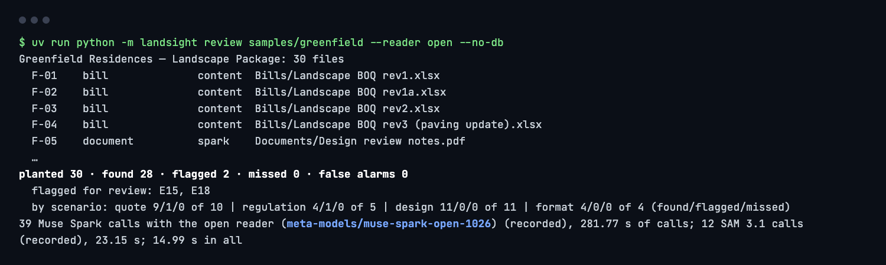
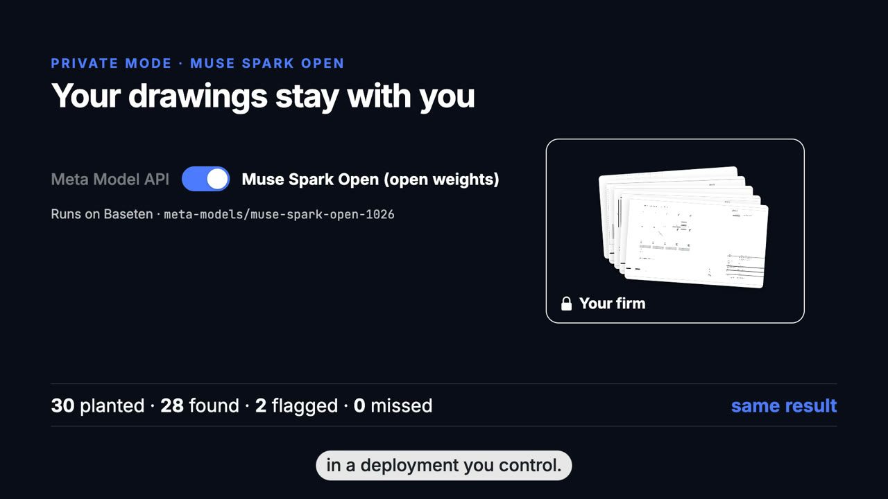

# Muse Spark Open: the open-weight model, where it runs, and the evidence

[← README](../README.md)

## The model and where it runs

- **Model:** Muse Spark Open, Meta's open weights, model id **`meta-models/muse-spark-open-1026`** ([model page](https://dev.meta.ai/models/muse-spark-open/)).
- **Where it runs:** on **Baseten**, through its OpenAI-compatible endpoint `https://inference.baseten.co/v1` (key in `BASETEN_API_KEY`). `LANDSIGHT_OPEN_BASE_URL` points the same code at any other OpenAI-compatible server, such as one a firm runs itself; so far it has been run on Baseten only.
- **What it does in the workflow:** in the private mode it takes every Muse Spark call of a review and of Ask the package, with the same prompts and JSON schemas as Muse Spark 1.3 on the Meta Model API: classifying every sheet, reading drawing groups, the plant schedule, the legend, the tree-pit detail and the raster plan, aligning bill rows, summarising documents and answering questions with citations. SAM 3.1 still measures the colour plans on the Meta Model API.
- **How to switch:** `--reader open`, `LANDSIGHT_READER=open` or `?reader=open` ([NEW-MODES.md](NEW-MODES.md)).

## The run

One live review of the 30-file sample package ran on Baseten on 2026-11-03 from 22:00:17 to 22:05:20 UTC, plus one question to Ask the package. All 40 answers were recorded with the model name, Baseten's response id, the time, the seconds and the tokens; the review replays from them with no key. On the sample the scoreboard is the same as with Muse Spark 1.3: 28 found, 2 flagged for a person, 0 missed. One reading differs: Muse Spark Open read one tree drawn as loose lines (T-08) as a planter edge, and it is left for a person to confirm.





| Call | Calls | Seconds | Prompt tokens | Completion tokens |
| --- | ---: | ---: | ---: | ---: |
| `review_classify_sheet` | 22 | 197.2 | 81,494 | 6,691 |
| `review_summarise` | 7 | 17.7 | 4,476 | 4,353 |
| `review_look_image` | 2 | 10.1 | 914 | 689 |
| `group_and_read` | 2 | 15.8 | 4,790 | 1,594 |
| `read_schedule` | 1 | 7.6 | 2,569 | 475 |
| `read_detail` | 1 | 9.0 | 3,457 | 356 |
| `review_align` | 1 | 2.7 | 811 | 986 |
| `read_legend` | 2 | 8.4 | 1,248 | 892 |
| `review_read_raster_plan` | 1 | 13.2 | 4,612 | 1,230 |
| `ask_package` | 1 | 2.4 | 3,033 | 550 |
| **All** | **40** | **284.2** | **107,404** | **17,816** |

<details><summary>Every recorded call (model, Baseten response id, time)</summary>

| Recorded (UTC) | Call | Model | Response id | Seconds | Recording |
| --- | --- | --- | --- | ---: | --- |
| 22:00:17 | `review_classify_sheet` | `meta-models/muse-spark-open-1026` | `chatcmpl-0950d18661584c90b0e39c929b64666a` | 5.32 | [review_classify_sheet__ca888507db49582a.json](../tests/fixtures/open/review_classify_sheet__ca888507db49582a.json) |
| 22:00:18 | `review_classify_sheet` | `meta-models/muse-spark-open-1026` | `chatcmpl-5e018cee55604b11a7f891629f03ba1f` | 6.82 | [review_classify_sheet__7cc9bf0453fb21bd.json](../tests/fixtures/open/review_classify_sheet__7cc9bf0453fb21bd.json) |
| 22:00:19 | `review_classify_sheet` | `meta-models/muse-spark-open-1026` | `chatcmpl-125eab0e302b45f6bcb2e8bca5d60243` | 7.57 | [review_classify_sheet__d88e7d5f4f18d941.json](../tests/fixtures/open/review_classify_sheet__d88e7d5f4f18d941.json) |
| 22:00:20 | `review_classify_sheet` | `meta-models/muse-spark-open-1026` | `chatcmpl-955b039b7a944d8f8083909c3b6d9fd9` | 8.33 | [review_classify_sheet__c5e728380d90081e.json](../tests/fixtures/open/review_classify_sheet__c5e728380d90081e.json) |
| 22:00:23 | `review_classify_sheet` | `meta-models/muse-spark-open-1026` | `chatcmpl-5d639603613b49c3b2a34efcd3cd3575` | 11.85 | [review_classify_sheet__86e60ba7119c6b5f.json](../tests/fixtures/open/review_classify_sheet__86e60ba7119c6b5f.json) |
| 22:00:24 | `review_classify_sheet` | `meta-models/muse-spark-open-1026` | `chatcmpl-336996a170be40fea488fd8b8a039715` | 7.18 | [review_classify_sheet__c0abf59153db3a57.json](../tests/fixtures/open/review_classify_sheet__c0abf59153db3a57.json) |
| 22:00:27 | `review_classify_sheet` | `meta-models/muse-spark-open-1026` | `chatcmpl-0eb3a61901984635abeb174dd9d8aa74` | 8.57 | [review_classify_sheet__b4fe13046d19dd68.json](../tests/fixtures/open/review_classify_sheet__b4fe13046d19dd68.json) |
| 22:00:28 | `review_classify_sheet` | `meta-models/muse-spark-open-1026` | `chatcmpl-4a960c54caf9428cbb1b5a46c7c0a894` | 8.35 | [review_classify_sheet__064861440aabeb0f.json](../tests/fixtures/open/review_classify_sheet__064861440aabeb0f.json) |
| 22:00:28 | `review_classify_sheet` | `meta-models/muse-spark-open-1026` | `chatcmpl-d0b7af412c3342f8b4b75acb59185f94` | 16.02 | [review_classify_sheet__476e6ad9054e59d7.json](../tests/fixtures/open/review_classify_sheet__476e6ad9054e59d7.json) |
| 22:00:29 | `review_classify_sheet` | `meta-models/muse-spark-open-1026` | `chatcmpl-e4dda8fde9f94ee29d6387cb09e680d8` | 9.28 | [review_classify_sheet__6b018368759f5830.json](../tests/fixtures/open/review_classify_sheet__6b018368759f5830.json) |
| 22:00:32 | `review_classify_sheet` | `meta-models/muse-spark-open-1026` | `chatcmpl-71faa1f32bcf4d1890d3c6e1d8ea209f` | 8.06 | [review_classify_sheet__b8d9b0e54ea6686b.json](../tests/fixtures/open/review_classify_sheet__b8d9b0e54ea6686b.json) |
| 22:00:32 | `review_classify_sheet` | `meta-models/muse-spark-open-1026` | `chatcmpl-a5efe9a9868c41b291fc89aadf4411ea` | 4.50 | [review_classify_sheet__fc53e891f369a553.json](../tests/fixtures/open/review_classify_sheet__fc53e891f369a553.json) |
| 22:00:34 | `review_classify_sheet` | `meta-models/muse-spark-open-1026` | `chatcmpl-a8ffaeec88414f01b145c6f9bffb1b33` | 9.43 | [review_classify_sheet__6b9c347001358cc2.json](../tests/fixtures/open/review_classify_sheet__6b9c347001358cc2.json) |
| 22:00:35 | `review_classify_sheet` | `meta-models/muse-spark-open-1026` | `chatcmpl-b4d6c6b634994305859630e1d6daa2dc` | 7.79 | [review_classify_sheet__5965c659b290b6be.json](../tests/fixtures/open/review_classify_sheet__5965c659b290b6be.json) |
| 22:00:37 | `review_classify_sheet` | `meta-models/muse-spark-open-1026` | `chatcmpl-06976085b09b4d1d842a936466dec1a9` | 7.93 | [review_classify_sheet__b00c4cfa4bf84a8d.json](../tests/fixtures/open/review_classify_sheet__b00c4cfa4bf84a8d.json) |
| 22:00:39 | `review_classify_sheet` | `meta-models/muse-spark-open-1026` | `chatcmpl-4f0f43ba10bc4b8883b27bd70df5c64d` | 7.71 | [review_classify_sheet__d7cfa2bf8678a832.json](../tests/fixtures/open/review_classify_sheet__d7cfa2bf8678a832.json) |
| 22:00:39 | `review_classify_sheet` | `meta-models/muse-spark-open-1026` | `chatcmpl-b547a03d68394872b2322a1bc315ccc4` | 7.86 | [review_classify_sheet__2131d56450a18403.json](../tests/fixtures/open/review_classify_sheet__2131d56450a18403.json) |
| 22:00:39 | `review_classify_sheet` | `meta-models/muse-spark-open-1026` | `chatcmpl-fdc6dd9c1de94da2a5f3055a7f709594` | 11.48 | [review_classify_sheet__e40054ab2398b141.json](../tests/fixtures/open/review_classify_sheet__e40054ab2398b141.json) |
| 22:00:41 | `review_classify_sheet` | `meta-models/muse-spark-open-1026` | `chatcmpl-4675b2b0a4544b78bb900e892736c18f` | 7.77 | [review_classify_sheet__74c6be973eef1a7a.json](../tests/fixtures/open/review_classify_sheet__74c6be973eef1a7a.json) |
| 22:00:41 | `review_summarise` | `meta-models/muse-spark-open-1026` | `chatcmpl-85cbbfca86724fc6a18af64386d10b2d` | 1.93 | [review_summarise__c591ed610ec6a6a8.json](../tests/fixtures/open/review_summarise__c591ed610ec6a6a8.json) |
| 22:00:42 | `review_summarise` | `meta-models/muse-spark-open-1026` | `chatcmpl-f09244349aee45ddad3e33c278a8a754` | 2.56 | [review_summarise__40394bfc146ef356.json](../tests/fixtures/open/review_summarise__40394bfc146ef356.json) |
| 22:00:44 | `review_summarise` | `meta-models/muse-spark-open-1026` | `chatcmpl-49b27f8011a142ff87bf74e39e8a683d` | 2.36 | [review_summarise__22a2df063ca3c28b.json](../tests/fixtures/open/review_summarise__22a2df063ca3c28b.json) |
| 22:00:44 | `review_summarise` | `meta-models/muse-spark-open-1026` | `chatcmpl-5e56c07fda174be1bf722f8b9e56c64f` | 2.76 | [review_summarise__9daea9710ee23ad2.json](../tests/fixtures/open/review_summarise__9daea9710ee23ad2.json) |
| 22:00:45 | `review_classify_sheet` | `meta-models/muse-spark-open-1026` | `chatcmpl-c484bdf2cdcb4ebc8da1aea00e93c541` | 9.96 | [review_classify_sheet__346169885f4e09ca.json](../tests/fixtures/open/review_classify_sheet__346169885f4e09ca.json) |
| 22:00:45 | `review_summarise` | `meta-models/muse-spark-open-1026` | `chatcmpl-28b4d1a3c90245598f88b8de982dc762` | 3.18 | [review_summarise__8f5453771967d76a.json](../tests/fixtures/open/review_summarise__8f5453771967d76a.json) |
| 22:00:46 | `review_summarise` | `meta-models/muse-spark-open-1026` | `chatcmpl-73a24ed2c0914492b746d9df25158c63` | 2.68 | [review_summarise__3b859a71f3c7cdb0.json](../tests/fixtures/open/review_summarise__3b859a71f3c7cdb0.json) |
| 22:00:46 | `review_summarise` | `meta-models/muse-spark-open-1026` | `chatcmpl-bd48d31c5a284518a60e934576461306` | 2.23 | [review_summarise__aa6077df2a80ae6b.json](../tests/fixtures/open/review_summarise__aa6077df2a80ae6b.json) |
| 22:00:50 | `review_classify_sheet` | `meta-models/muse-spark-open-1026` | `chatcmpl-f6861b44d54b482da2f76e0df1f38f0a` | 11.11 | [review_classify_sheet__21a7f8e131c07310.json](../tests/fixtures/open/review_classify_sheet__21a7f8e131c07310.json) |
| 22:00:51 | `review_classify_sheet` | `meta-models/muse-spark-open-1026` | `chatcmpl-50fc9a5adf754b268416bb63d9b13528` | 14.26 | [review_classify_sheet__7405ae0f4a1e3336.json](../tests/fixtures/open/review_classify_sheet__7405ae0f4a1e3336.json) |
| 22:00:58 | `review_look_image` | `meta-models/muse-spark-open-1026` | `chatcmpl-c5092c5e441b4c22b3bcce87ed4e2f7b` | 4.76 | [review_look_image__6b1d5b78163fe258.json](../tests/fixtures/open/review_look_image__6b1d5b78163fe258.json) |
| 22:00:58 | `review_look_image` | `meta-models/muse-spark-open-1026` | `chatcmpl-c8eec8f0ec634b8cb21ca4f8b245cfdc` | 5.33 | [review_look_image__846c79200edb0f88.json](../tests/fixtures/open/review_look_image__846c79200edb0f88.json) |
| 22:01:04 | `group_and_read` | `meta-models/muse-spark-open-1026` | `chatcmpl-47b2e3c133f344cab821a7311a7d170c` | 8.31 | [group_and_read__17091963f3b3889c.json](../tests/fixtures/open/group_and_read__17091963f3b3889c.json) |
| 22:01:14 | `read_schedule` | `meta-models/muse-spark-open-1026` | `chatcmpl-9f250e69fecc4cc596faeea8f3cd693b` | 7.63 | [read_schedule__1e8ab053636609a1.json](../tests/fixtures/open/read_schedule__1e8ab053636609a1.json) |
| 22:01:23 | `read_detail` | `meta-models/muse-spark-open-1026` | `chatcmpl-d9bfd3c97afc4c9994a4343c08cd1ec9` | 9.03 | [read_detail__8680a66707d34202.json](../tests/fixtures/open/read_detail__8680a66707d34202.json) |
| 22:01:33 | `group_and_read` | `meta-models/muse-spark-open-1026` | `chatcmpl-7f446793b2ac4c749873945c057f33c7` | 7.53 | [group_and_read__f2a542a9ff2cf99f.json](../tests/fixtures/open/group_and_read__f2a542a9ff2cf99f.json) |
| 22:01:37 | `review_align` | `meta-models/muse-spark-open-1026` | `chatcmpl-1c5fd443657942d4aaa09ffd0bb6f7ce` | 2.74 | [review_align__8628be136a5f80cb.json](../tests/fixtures/open/review_align__8628be136a5f80cb.json) |
| 22:01:41 | `read_legend` | `meta-models/muse-spark-open-1026` | `chatcmpl-cf302bd5d67141d9a55110d61bf02738` | 4.25 | [read_legend__c675ef7cfe08efde.json](../tests/fixtures/open/read_legend__c675ef7cfe08efde.json) |
| 22:01:53 | `read_legend` | `meta-models/muse-spark-open-1026` | `chatcmpl-907b7dc8b7924e38b4026af10dbe7e07` | 4.18 | [read_legend__f72f54ec0a967921.json](../tests/fixtures/open/read_legend__f72f54ec0a967921.json) |
| 22:02:09 | `review_read_raster_plan` | `meta-models/muse-spark-open-1026` | `chatcmpl-98a8cb694a25475f93ba2471b1a2df4a` | 13.16 | [review_read_raster_plan__ea7cc58300a07ee6.json](../tests/fixtures/open/review_read_raster_plan__ea7cc58300a07ee6.json) |
| 22:05:20 | `ask_package` | `meta-models/muse-spark-open-1026` | `chatcmpl-87ba480796a64bb39fae9a3f4e4ee4cb` | 2.41 | [ask_package__e82f69f286738f47.json](../tests/fixtures/open/ask/ask_package__e82f69f286738f47.json) |

</details>

## Sample outputs

**Reading a legend** (`read_legend`, response `chatcmpl-cf302bd5d67141d9a55110d61bf02738`, 4.25 s): each swatch's colour word, label and kind; the colour words become SAM 3.1's prompts.

```json
[
 {
  "swatch_colour_word": "light green",
  "label": "CC CAMPHOR",
  "kind": "symbol"
 },
 {
  "swatch_colour_word": "light green",
  "label": "AZ AZALEA",
  "kind": "area"
 },
 {
  "swatch_colour_word": "light grey",
  "label": "FIRE TRUCK ACCESS LANE",
  "kind": "area"
 },
 {
  "swatch_colour_word": "dark green",
  "label": "DU DURANTA",
  "kind": "line"
 }
]
```

**Asking the package** (`ask_package`, response `chatcmpl-87ba480796a64bb39fae9a3f4e4ee4cb`, 2.41 s): "Is PV-1 a permeable paver, and which sheet or document says so?"

```json
{
 "answer": "Yes, PV-1 is a permeable paver. The Paving Plan legend on drawing L-3 (drawing L-3 dated 2026-09-18) keys PV-1 as PERMEABLE PAVERS, and the package's BOQ and paving specification describe Permeable pavers (PV-1) as concrete, 200 x 100 x 80 mm, on 30 mm sand.",
 "citations": [
  {
   "file_id": "F-25",
   "page": 4,
   "quote": "PV-1 PERMEABLE PAVERS"
  },
  {
   "file_id": "F-16",
   "page": 0,
   "quote": "PV-1 PERMEABLE PAVERS"
  }
 ],
 "confidence": 0.98
}
```

## Try it

```bash
uv run python -m landsight review samples/greenfield --reader open --no-db   # replays the recorded run, no key
BASETEN_API_KEY=… uv run python -m landsight review samples/greenfield --reader open --live --db out/open.db   # live on Baseten
```
